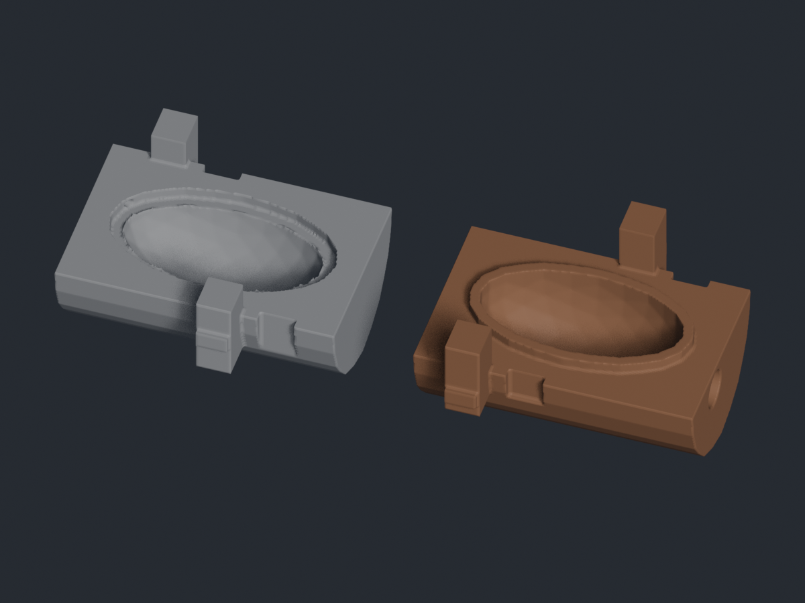

# E3P MoldMaker

Turn an STL part into printable split molds for silicone casting. E3P MoldMaker
combines a Blender geometry pipeline with a Cura extension for choosing the
parting view, generating mold pieces, and bringing them back onto the build plate.

The original workflow has been used to print molds and cast silicone parts.
That is author-reported use of the original tool; this release's reproducible
software checks are documented separately in [validation](docs/validation.md).



## Run the generator

Use **Python 3.12+** for the launcher and **Blender 5.2.0** for geometry generation.
Blender supplies its own Python and geometry APIs. Start in a virtual environment:

```sh
python -m pip install -r requirements.txt .
python tools/make_demo.py --blender-exe /path/to/blender --output demo-output
```

For your own STL, choose a new output directory:

```sh
python -m e3p_mold generate part.stl --blender-exe /path/to/blender -o mold-output --report mold-output/report.json
```

On Windows, quote the executable path, for example
`"C:\Program Files\Blender Foundation\Blender 5.2\blender.exe"`.
The launcher reports validated output files and any fallback used. An existing
output directory is rejected. Generated STL files and run logs stay local.

Parameters include cavity clearance, wall/base/top thickness, parting view and
angle, alignment keys, perimeter locking, and an optional center insert. Use
`python -m e3p_mold generate --help` for the full interface. Preview the six parting
views with `python -m e3p_mold preview part.stl --blender-exe /path/to/blender -o previews`.

`--voxel-size` makes the mesh resolution explicit. The default preserves the
original fine-resolution heuristic; a larger value trades small-feature fidelity
for smaller meshes and faster processing. It is not a dimensional-accuracy setting.
The pictured demo uses a 0.25 mm voxel size and explicitly enables
`--allow-mesh-repair`; its report records the geometry removed during repair.
Ordinary generation rejects results that need destructive repair unless that
option is supplied. Inspect repaired geometry before printing it.

## Use the Cura extension

The adapter targets **Cura 5.12 / SDK 8.12** and uses a separately configured
Python environment for the launcher. Install from this source checkout into an
explicit Cura plugins directory:

```sh
python tools/install_cura_extension.py --destination /path/to/cura/5.12/plugins/E3PBlenderMold
```

Restart Cura and set the source checkout, external Python and Blender paths in
**Extensions → E3P → Blender Mold Settings**. Open **Generate Mold Halves**. Select the
original STL, set a parting view/angle, and generate. Both image previews and
generation run in background jobs that can be cancelled. Successful generation
queues only the files named in the validated result for Cura import.

The input is the original STL file. Scale, rotation and other edits made to its
Cura scene object are not applied; export those changes to a new STL first.
See [installation and compatibility](docs/cura.md) for the adapter's validation scope.

## Engineering to inspect

| Area | Implementation |
| --- | --- |
| Geometry | Convex hulls, polygon offsets, plane cuts, Boolean cavity subtraction, split-cap extraction and extrusion |
| Mold features | Alignment keys, perimeter locks, optional center inserts, injection and vent channels |
| Print orientation | Candidate rotations scored for cavity access, overhang area and bed contact |
| Process ownership | Time limits, cancellation, isolated attempts and bounded logs across the Cura → Python → Blender chain |
| Result validation | Explicit artifact manifests; finite, closed, consistently wound, single-component STL output with positive volume |

[Architecture](docs/architecture.md) explains the boundaries and retry behavior.
[Provenance](docs/provenance.md) separates the original geometry work from release maintenance.

## Run the checks

```sh
python -m pip install -r requirements-dev.txt -e .
python -m ruff check .
python -m unittest discover -s tests -v
python tools/verify_geometry.py --blender-exe /path/to/blender --output verification-output
python -m build
```

The ordinary tests exercise algorithms and injected process failures. Geometry
verification actually runs Blender on generated fixtures. Neither replaces
inspection of a new model and a physical fit/casting trial.

## Scope

Normal offsets, voxel remeshing and Boolean operations approximate geometry.
A closed mesh does not establish exact clearance, minimum wall thickness,
channel connectivity, freedom from undercuts, or successful demolding. Automatic
repair is explicit because removing components or sealing holes can change intent.
Alignment keys at arbitrary parting angles remain unsupported; the result warns
when that feature is disabled. Center-insert fallback is reported in the result.

MIT licensed. Blender, Cura and Python dependencies are separately installed and
retain their own licenses. The repository includes generated demonstrations;
original private models, device configuration and unrelated workspace data are excluded.
