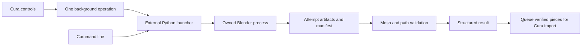

# Architecture

The Cura adapter is an optional front end. The same generator can be run from a
terminal, so geometry validation does not require Cura or a printer.

Each attempt has its own directory. A center-insert failure may lead to a
cavity-derived insert attempt or a two-piece fallback. The current attempt's
structured outcome determines the next step; diagnostic text from an earlier
failure does not turn a successful retry into another failure. A center STL
outside the successful manifest is never offered for import.

The launcher owns Blender's process lifetime. Timeouts and cancellation act on
that operation's process tree, not on unrelated Blender windows. Logs and input/
output sizes have configured limits. These limits do not establish a hard bound
on all memory used internally by Blender's Boolean and remeshing operations.
Validation checks cancellation and the remaining deadline between array
operations and periodically during graph traversal; an individual array operation
can finish after the deadline. Windows Job Objects own descendant processes.
On Linux, nested sessions are discovered while the ancestor is still alive;
after it exits, only the original process group is guaranteed. The trusted
launcher and Blender command must not daemonize into detached sessions.

The geometry engine constructs a cavity cutter from the part, forms the outer
mold body, splits closed solids, and subtracts matching half-cutters. Splitting
before subtraction avoids filling the cavity openings when capping the split.
Optional features add locks, keys, inserts and channels. Print orientation ranks
a finite set of rotations by cavity accessibility, estimated overhang and contact.

Geometry checks reject malformed results, but they do not solve mold design.
Voxel resolution, normal displacement and repair can affect fit; undercuts and
enclosed cavities can require deliberate core/parting design. Review the generated
pieces and test their physical fit before relying on a new input model.
